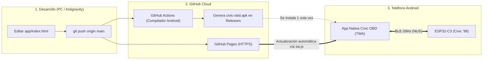

# Plan Técnico: Conversión de la Web App a APK Android Auto-Actualizable

Este documento detalla el análisis de arquitectura, compatibilidad con **Web Bluetooth (`navigator.bluetooth`)** y la hoja de ruta paso a paso para empaquetar el dashboard de telemetría del **Honda Civic '99 (`app/`)** en un archivo instalable **`.apk`** con actualizaciones automáticas.

---

## 1. Diagnóstico del Estado Actual del Proyecto (`app/`)

Tras auditar los archivos actuales del repositorio (`https://github.com/fedelt01hub/honda-civic-scanner`), **el 80% de la infraestructura para un APK auto-actualizable ya está construida**:

1. **Manifiesto PWA ([`app/manifest.json`](app/manifest.json)):**
   * Ya define `display: "standalone"`, `orientation: "portrait-primary"`, colores (`#0a0d14`) e íconos `192x192` y `512x512` con soporte `any maskable`.
2. **Service Worker Offline + Auto-Update ([`app/sw.js`](app/sw.js) y [`app/index.html`](app/index.html)):**
   * `app/sw.js` implementa una estrategia **Stale-While-Revalidate** sobre `index.html` y caché persistente (`civic-obd-v23`). Esto garantiza que la aplicación abra instantáneamente en el auto **sin necesidad de datos móviles ni Wi-Fi**, pero descargue actualizaciones silenciosamente en segundo plano cuando hay internet.
   * `app/index.html` (líneas 1378–1401) ya ejecuta `reg.update()` al iniciar y escucha los eventos `updatefound` y `controllerchange` para recargar la interfaz en cuanto detecta una versión nueva en el servidor.
3. **Dependencias Críticas de Hardware en el Navegador:**
   * **Web Bluetooth API (`navigator.bluetooth`):** Uso del servicio Nordic UART (`6e400001-b5a3-f393-e0a9-e50e24dcca9e`) para recibir tramas binarias a 20 Hz y enviar comandos (`GET_DTC`, `CLEAR_DTC`, `GET_DIAG`).
   * **Screen Wake Lock API (`navigator.wakeLock`):** Mantiene la pantalla encendida mientras el teléfono está en el tablero.
   * **Blob / File Download:** Exportación directa de logs `.csv` de telemetría.

---

## 2. El Reto Técnico Principal: WebView vs. Trusted Web Activity (TWA)

> [!IMPORTANT]
> **¿Por qué no usar un APK de WebView convencional?**
> El componente `android.webkit.WebView` nativo del sistema Android (usado por defecto en contenedores simples, Cordova o Capacitor básico) **NO tiene implementada la API `navigator.bluetooth`**. Si se empaqueta `index.html` en un WebView estándar, al presionar *"Conectar Bluetooth"* aparecerá el error: *"Tu navegador no soporta Web Bluetooth"*.

### Comparativa de las 2 Arquitecturas Viables para Generar el `.apk`

| Característica | Vía 1: APK con TWA (Trusted Web Activity) ⭐ *Recomendada* | Vía 2: APK con Capacitor + Plugin BLE Nativo |
| :--- | :--- | :--- |
| **Motor de ejecución** | Motor de Google Chrome del dispositivo en contenedor nativo | `System WebView` + Puente Java/Kotlin |
| **Cambios en código JS (`index.html`)** | **Ninguno (0 líneas).** `navigator.bluetooth` y `wakeLock` funcionan de forma 100% nativa | **Alto.** Requiere reescribir toda la capa BLE usando `@capacitor-community/bluetooth-le` |
| **Peso del archivo `.apk`** | **~1.5 MB a 2 MB** | **~8 MB a 15 MB** |
| **Cómo se actualiza la App** | **Automático vía Git (`git push`):** El Service Worker actualiza el contenido del APK instalado sin bajar otro APK | Requiere integrar un servicio OTA (ej. Capgo) o programar descarga e instalación manual de `.apk` desde GitHub Releases |
| **Funcionamiento sin internet (en ruta)** | **100% Offline** tras el primer inicio gracias a `app/sw.js` | **100% Offline** desde la instalación |
| **Dificultad de implementación** | **Baja (1 hora)** — Automatizable con GitHub Actions | **Media-Alta (1 a 2 días)** |

---

## 3. Arquitectura de la Solución Recomendada (TWA + GitHub Pages + GitHub Actions)



### ¿Cómo funciona la actualización sin reinstalar el APK?
1. Instalas `civic-obd.apk` en tu Android **una única vez**.
2. El APK valida mediante el archivo `.well-known/assetlinks.json` que eres el dueño del repositorio en GitHub Pages, eliminando por completo la barra de direcciones y ejecutándose como una aplicación nativa pura.
3. Cuando mejoras algo en `app/index.html` (por ejemplo, un nuevo reloj, ajuste de fórmula o diagnóstico) y haces `git push`:
   * GitHub Pages publica el cambio en ~30 segundos.
   * La próxima vez que abras la app en tu celular con conexión a internet, el Service Worker (`sw.js`) detecta los bytes nuevos, actualiza la caché local y recarga la interfaz automáticamente a la nueva versión.
   * Cuando sales al auto sin Wi-Fi, la app abre al instante desde la caché actualizada del teléfono.

---

## 4. Plan de Implementación Paso a Paso

### Fase 1: Ajustes en `app/` para Validación TWA y Control de Versiones

#### 1.1. Mejorar [`app/manifest.json`](app/manifest.json)
Agregar un `id` único estable y separar los propósitos de los íconos (`any` y `maskable`), requisito exigido por `Bubblewrap` para compilar el APK sin advertencias:

```json
{
  "id": "/honda-civic-scanner/app/",
  "name": "Honda Civic '99 Scanner & Datalogger",
  "short_name": "Civic OBD",
  "description": "Escáner PGM-FI y Datalogger Bluetooth para Honda Civic '99",
  "start_url": "./index.html",
  "scope": "./",
  "display": "standalone",
  "orientation": "portrait-primary",
  "background_color": "#0a0d14",
  "theme_color": "#0a0d14",
  "prefer_related_applications": false,
  "icons": [
    {
      "src": "./icon-192.png",
      "sizes": "192x192",
      "type": "image/png",
      "purpose": "any"
    },
    {
      "src": "./icon-192.png",
      "sizes": "192x192",
      "type": "image/png",
      "purpose": "maskable"
    },
    {
      "src": "./icon-512.png",
      "sizes": "512x512",
      "type": "image/png",
      "purpose": "any"
    },
    {
      "src": "./icon-512.png",
      "sizes": "512x512",
      "type": "image/png",
      "purpose": "maskable"
    }
  ]
}
```

#### 1.2. Optimizar [`app/sw.js`](app/sw.js) para Actualización Instantánea de Recursos
Actualmente `sw.js` aplica *Stale-While-Revalidate* solo a peticiones HTML (`isHtml`), pero usa *Cache-First* estricto en el resto. Para que no sea necesario cambiar manualmente `CACHE_NAME` en cada pequeño cambio:
* Permitir que `sw.js` escuche el mensaje `{ type: 'SKIP_WAITING' }`.
* Añadir un indicador visual discreto en la barra superior o pestaña de diagnóstico de `app/index.html` con el número de versión actual y un botón para forzar búsqueda de actualización si se desea.

---

### Fase 2: Vinculación Digital (Digital Asset Links)

Para que Android confíe en el APK y lo muestre a pantalla completa (sin barra de URL superior):

1. **Generar Keystore de Firma Android (`civic-obd.keystore`):**
   ```bash
   keytool -genkeypair -v -keystore civic-obd.keystore -alias civic-key -keyalg RSA -keysize 2048 -validity 10000
   ```
2. **Obtener la huella SHA-256 del certificado:**
   ```bash
   keytool -list -v -keystore civic-obd.keystore -alias civic-key
   ```
3. **Crear `app/.well-known/assetlinks.json` (y en la raíz del dominio de GitHub Pages):**
   ```json
   [
     {
       "relation": ["delegate_permission/common.handle_all_urls"],
       "target": {
         "namespace": "android_app",
         "package_name": "io.github.fedelt01hub.civicobd",
         "sha256_cert_fingerprints": [
           "AA:BB:CC:DD:...:SHA256_DE_TU_KEYSTORE"
         ]
       }
     }
   ]
   ```

---

### Fase 3: Configuración del Proyecto Android TWA (`twa-manifest.json`)

Crear la carpeta o configuración de **Bubblewrap** con los metadatos del paquete Android:
* **Package ID:** `io.github.fedelt01hub.civicobd`
* **Host:** `fedelt01hub.github.io`
* **Start Path:** `/honda-civic-scanner/app/index.html` (o `/civic-obd/index.html` según el repo activo de Pages)
* **Theme / Navigation Bar Color:** `#0a0d14`
* **Splash Screen Fade Out:** `300ms`

---

### Fase 4: Compilación Automática del APK con GitHub Actions (Sin instalar Android Studio en tu PC)

Para no tener que instalar ni configurar gigabytes de Android SDK / Java JDK localmente en Windows, se crea el flujo `.github/workflows/build-apk.yml`:

* Se ejecuta cuando lo solicites (`workflow_dispatch`) o al crear un tag (`v1.*`).
* Instala Node.js, JDK 17 y Android SDK en la nube de GitHub.
* Ejecuta `@bubblewrap/cli build` firmando el APK con el Keystore del proyecto.
* Sube automáticamente el archivo **`Civic-OBD-Scanner.apk`** listo para descargar en la sección **Releases / Actions** de tu repositorio de GitHub.

---

## 5. Alternativa Opcional: Si se requiere reescritura nativa con Capacitor (Vía 2)

En caso de que en el futuro se desee prescindir por completo de Chrome en el teléfono y usar el `WebView` del sistema:

1. Inicializar Capacitor:
   ```bash
   npm init -y
   npm install @capacitor/core @capacitor/cli @capacitor/android @capacitor-community/bluetooth-le
   npx cap init "Civic OBD" "io.github.fedelt01hub.civicobd" --web-dir app
   npx cap add android
   ```
2. Configurar permisos en `android/app/src/main/AndroidManifest.xml`:
   * `BLUETOOTH_SCAN` (`neverForLocation`)
   * `BLUETOOTH_CONNECT`
   * `ACCESS_FINE_LOCATION` (para Android <= 11)
3. Crear un adaptador BLE en `app/index.html` que detecte `window.Capacitor?.isNativePlatform()` y redirija `toggleBleConnection()`, `sendBleCmd()` y el callback de notificaciones de `navigator.bluetooth` a `BleClient` de `@capacitor-community/bluetooth-le`.
4. Añadir un verificador de versión contra `https://api.github.com/repos/fedelt01hub/honda-civic-scanner/releases/latest` para avisar cuando exista un nuevo `.apk`.

---

## 6. Lista de Verificación para Puesta en Marcha

- [x] **Paso 1:** Confirmar la URL exacta de GitHub Pages activa (`https://fedelt01hub.github.io/civic-obd/`). ✅ Confirmada: es la activa.
- [x] **Paso 2:** Actualizar `app/manifest.json` y `app/sw.js` con soporte de actualización mejorado y botón de verificación de versión en la UI.
- [x] **Paso 3:** Generar el keystore de firma y preparar `.well-known/assetlinks.json` (`twa/user-site/`). ⏳ Falta publicarlo en el repo `fedelt01hub.github.io` (ver `twa/README.md`).
- [x] **Paso 4:** Crear el workflow `.github/workflows/build-apk.yml` (o compilar localmente con Bubblewrap) para obtener el archivo `Civic-OBD-Scanner.apk`.
- [ ] **Paso 5:** Instalar el `.apk` en el teléfono Android y validar:
  1. Apertura en pantalla completa (sin barra de navegador).
  2. Conexión Bluetooth con el ESP32 (`Civic_KLine_BLE`).
  3. Apertura en modo avión / sin datos móviles (prueba offline).
  4. Actualización automática al modificar un texto en el repositorio.

